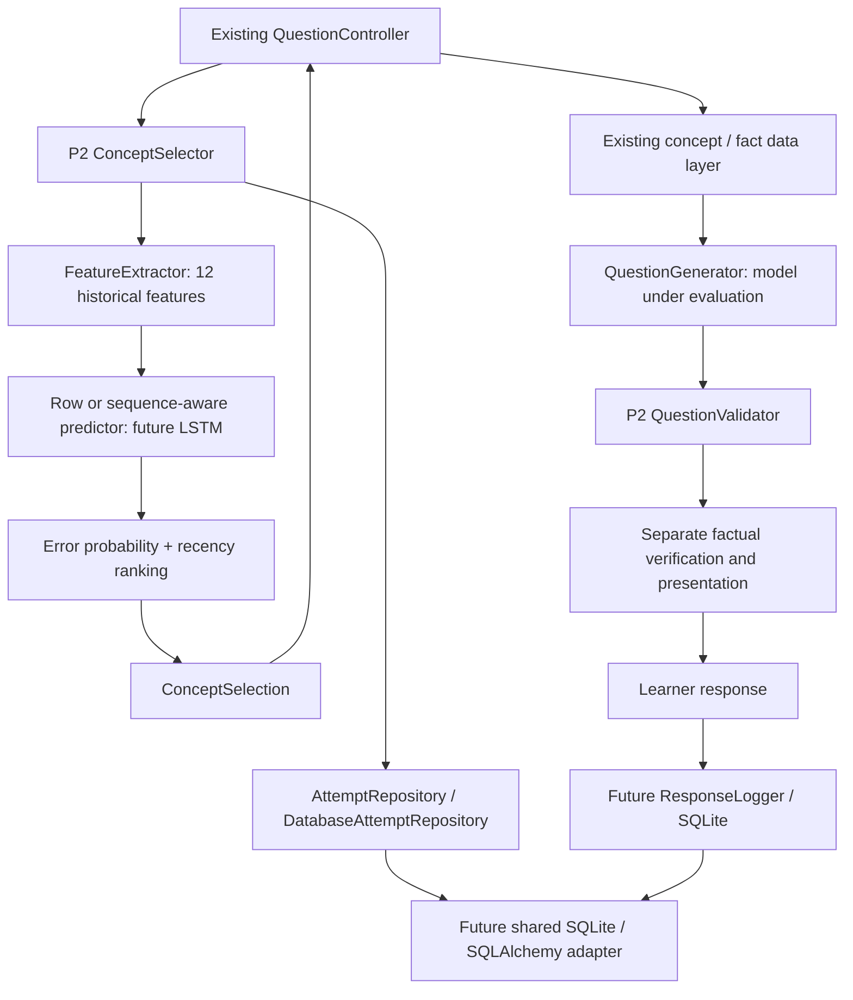

# P2: Non-neural adaptive study components

P2 provides learner-response records, the agreed 12 historical features, masked
feature vectors, repository/predictor interfaces, adaptive concept selection, and
structural multiple-choice validation. Runtime code uses the standard library.
Work is on the local `p2-branch`, created from current main. No neural models,
generation prompts, SQLAlchemy tables, migrations, Q&A controllers,
PDF extraction, or persistent logging are implemented here.

## Setup, tests, and demonstration

Standalone P2 supports Python 3.10+. The separate teammate design branch declares
Python >=3.14; integrated deployment must follow that branch's eventual agreed
configuration. Current verification uses Python 3.12.3, not Python 3.14.

From the repository root:

```sh
python3 -m venv P2/.venv
P2/.venv/bin/python -m pip install -r P2/requirements-dev.txt
P2/.venv/bin/python -m pytest -c P2/pytest.ini P2/tests
PYTHONPATH=P2 P2/.venv/bin/python P2/examples/demo_pipeline.py
```

Pytest is the only development dependency. Tests and the demo use synthetic data
and mock predictions; they require no model weights or database setup. The demo
selects `algebra` with error probability `0.8`, recency approximately `0.000001146`,
and final score approximately `0.640000229`. It prints all three candidates in
rank order: algebra, never-reviewed capitals, then fractions. Its probabilities
are explicitly mocked; the demo does not invoke a question generator.

## Files and documentation

```text
P2/
├── non_neural/
│   ├── __init__.py             # Public exports
│   ├── schemas.py              # Interaction and shared value checks
│   ├── feature_extractor.py    # 12 features and masked vector conversion
│   ├── adaptive_selector.py    # Existing standalone scoring helper
│   ├── concept_selector.py     # Controller-facing orchestration and results
│   ├── interfaces.py           # Storage/prediction protocols and request context
│   ├── project_adapter.py      # Bridge to the proposed controller-facing facade
│   └── question_validator.py   # Question records and structural results
├── tests/                      # Synthetic pytest coverage for all components
├── examples/demo_pipeline.py   # Executable integration example
├── docs/
│   ├── API.md                  # Signatures and contracts
│   ├── INTEGRATION.md          # Branch findings and teammate adapter guidance
│   └── WALKTHROUGH.md          # Worked practice cycle
├── requirements-dev.txt
├── pytest.ini
└── README.md
```

Read the [API reference](docs/API.md), [integration notes](docs/INTEGRATION.md),
and [walkthrough](docs/WALKTHROUGH.md) for detailed usage.

## Architecture and boundaries



The controller owns the Q&A cycle and retrieves selected concept facts. The
ControllerConceptSelector adapter retains PR #7's select_concept method shape and
returns the project's own Concept through an explicit lookup callback. P2 does
not replace it. Generation remains independent of selection: FLAN-T5-small,
Qwen3-8B Q4, and Qwen3-14B Q4 are possible models under evaluation. Nothing in P2
imports or assumes one of them.

## Standardized interactions

`Interaction` is an immutable dataclass validated at construction:

| Field | Type | Purpose |
| --- | --- | --- |
| learner_id | str | Group histories by learner |
| interaction_id | str | Unique response-event identifier |
| question_id | str | Identify the answered question |
| concept_ids | list[str] or tuple[str, ...] | One or more distinct concept associations; copied into a tuple |
| subject_id | str | Subject metadata for future routing |
| timestamp_ms | int | Nonnegative answer-availability timestamp in milliseconds |
| response_time_ms | int or None | Nonnegative duration in milliseconds, or unknown |
| correct | bool | Observed response correctness |

Identifiers must be nonblank strings. Convert numeric dataset IDs to strings;
normalize namespaces consistently in preprocessing. IDs are metadata or inputs
for an agreed identifier encoding, not ordinary continuous numerical features.
Do not feed raw learner IDs into the LSTM. Multiple skills on one question are
preserved. EdNet KT1, ASSISTments, and application-generated responses can map to
this representation; full importers are not implemented.

Source adapters must align timestamp origins, units, missing values, and answer
availability. If a dataset records question presentation time, do not expose its
answer as though it were already known at that time. Constructors reject boolean
or fractional timestamps/durations and non-boolean correctness values. Missing
required arguments raise `TypeError`; invalid values raise `ValueError`.

## Feature extraction and missingness

`extract_features(history, target_concept_id, prediction_timestamp_ms)` validates
one learner's records, stably sorts by timestamp without mutating the input, and
uses only timestamps **strictly less than** the prediction cutoff. Duplicate
interaction IDs and mixed-learner histories are errors. Equal-time prior records
retain supplied source order; all records exactly at the prediction time are
excluded. No target correctness or target response duration enters its own row.
The caller must still ensure that the cutoff precedes the target answer.

| Feature, in FEATURE_NAMES order | Definition |
| --- | --- |
| previous_response_time | Last prior interaction's duration, even if missing |
| previous_correct | Last prior interaction correctness as 0/1 |
| time_since_previous_interaction | Cutoff minus last prior timestamp |
| time_since_last_skill_attempt | Cutoff minus last target-concept timestamp |
| skill_attempt_count | Number of prior target-concept attempts |
| skill_avg_response_time | Mean known target-concept duration |
| skill_accuracy | Correct target-concept attempts / target-concept attempts |
| recent_skill_avg_response_time | Mean known duration in recent target-concept window |
| recent_skill_accuracy | Accuracy in recent target-concept window |
| skill_correct_streak | Correct streak ending at latest target-concept attempt |
| overall_accuracy | Correct prior responses / all prior responses |
| overall_attempt_count | Number of prior responses |

All time features use milliseconds; accuracies are fractions in [0, 1]. A
multi-concept question counts once overall and once for each associated concept.
Other concepts do not interrupt a target concept's streak. Accuracy is calculated
separately for each learner and concept, never stored as one global `Concept`
accuracy: learners can have very different mastery of the same concept.

For `n` prior skill attempts, the recent window size is:

```python
min(n, 50, floor(10 * ln(n + 1)))
```

This uses the natural logarithm: 147 attempts yield a 49-attempt window; 148 yield
50. Missing durations occupy attempt positions and count for accuracy but are
omitted from duration means. If none are known, the mean is `None`.

For unseen concepts, unknown accuracy, duration, and elapsed-time values are
`None`; counts and streaks are zero. Overall and previous-response statistics
still reflect the learner's other concepts. Empty histories have unknown overall
accuracy rather than an invented zero.

`to_feature_vector(features)` returns `FeatureVector(values, observed_mask)` in
`FEATURE_NAMES` order. Known values have mask `True`. Unknowns have placeholder
`0.0` with mask `False`, preserving the difference from a measured zero. This
mask has 12 entries and is a **feature observation mask**, not a sequence-padding
mask. The function does not scale or statistically impute values. It rejects
missing/extra keys and nonfinite or nonnumeric values.

The `previous_*`, `time_since_previous_interaction`, and `overall_*` features
describe the learner's chronological context. `skill_*`, `recent_skill_*`, and
`time_since_last_skill_attempt` describe the target concept at that cutoff.
Neither group alone is an implemented LSTM sequence. The neural teammate must
agree how chronological rows, target context, sequence masks, and feature masks
become the final model input while preserving the 12-feature schema.

## Repository and predictor interfaces

`AttemptRepository.get_history(learner_id, before_timestamp_ms=None)` returns
chronological `Interaction` records for exactly one learner and, when specified,
strictly before the cutoff. `InMemoryAttemptRepository` implements this contract
for synthetic data, with `add()` and duplicate-ID rejection. It has no persistence.

The SQLite teammate should implement the protocol over the shared ORM, or add
`DatabaseController.get_attempt_history(learner_id, before_timestamp_ms=None)`
and wrap it in `DatabaseAttemptRepository`. That method is proposed, not present
in PR #7 yet. Store
individual attempts with learner/question IDs, concept associations, answer
availability time, response duration, submitted answer, and correctness. Join
concept associations without duplicating a question attempt in overall statistics.
Submitted answer belongs to the future persistence model; it is not added to the
current interaction record or 12 features. Compute accuracy from attempts.
No new database schema is introduced here.

`ErrorPredictor.predict_error(learner_id, concept_id, subject_id, features)` supplies
a finite probability in [0, 1], where 1 means certain error. A correctness predictor
must convert with `1 - p`. `MockErrorPredictor` is a deterministic lookup keyed by
`(subject_id, concept_id)` and is for tests/demo only.

Both predictor signatures are provisional because no neural inference interface
is available in PR #6 or #7. For a sequence-based model, inject
`sequence_predictor=` instead of `predictor=`. It implements
`predict_error(request: PredictionRequest)` and receives chronological strictly
prior history, learner/target/subject metadata, the cutoff, read-only target-context
features, and their masked vector. Future/current answers are excluded even if
the repository failed to apply the cutoff. Exactly one predictor path is required.

The neural adapter owns sequence construction and any sequence masks, scaling,
padding, and identifier encoding. For each historical sequence row, compute its
features at that row's own prediction cutoff to prevent within-sequence leakage.
The raw history and 12-value dictionary are not a finalized LSTM tensor layout;
that remains an integration decision. Switching predictor paths does not change
selection scoring, database access, or the agreed feature schema.

## ConceptSelector and controller usage

```python
from non_neural import (
    CandidateConcept, ConceptSelector, InMemoryAttemptRepository, MockErrorPredictor,
)

selector = ConceptSelector(
    repository=InMemoryAttemptRepository(),
    predictor=MockErrorPredictor({('math', 'algebra'): 0.8}),
)
result = selector.select_next_concept(
    learner_id='learner_001',
    candidate_concepts=[CandidateConcept('algebra', 'math')],
    prediction_timestamp_ms=3000,
)
# No review: recency_score=1.0; selection_score approximately 0.84.
```

The selector retrieves history once, computes candidate features, obtains error
probabilities, and selects the highest score:

```text
recency = 1 - exp(-ln(2) * elapsed_ms / half_life_ms)
selection_score = alpha * predicted_error_probability + (1 - alpha) * recency
```

Defaults: `alpha=0.8`, `half_life_ms=604800000` (seven days). Recency is zero at
review, 0.5 after a half-life, and approaches one. Never-reviewed concepts receive
recency one; the predictor still receives unknown statistics, not fabricated
accuracy. This cold-start policy does not guarantee balanced diagnostic coverage.

`rank_concepts(learner_id, candidate_concepts, prediction_timestamp_ms)` returns
all candidates in descending-score order with lexical ID tie-breaking. It makes
one repository query and one prediction per candidate. `select_next_concept` uses
the same ranking and returns its first result. Reuse the returned ranking when
you need both the winner and all scores; calling both methods reruns inference.

The returned `ConceptSelection` contains concept ID, subject ID, predicted error
probability, recency score, selection score, and `used_fallback`. Scores are
priorities, not calibrated probabilities. Exact ties use lexical concept ID order.
Concept IDs must be globally namespaced; repeated IDs are rejected even if subjects
differ. Mixed-subject candidates are otherwise supported, with subject metadata
passed to the predictor.

Empty candidates and invalid probabilities are errors. Predictor exceptions raise
`PredictionError` with the original exception chained by default. Set
`fallback_error_probability=0.5` (or another explicit valid value) to continue on
inference exceptions; the selected result reports whether it used fallback. This
is an operational policy, not a trained estimate. Invalid returned probabilities
always raise `ValueError`, even with fallback enabled. Repository errors propagate.
The scoring formula is experimental and configurable.

The existing `QuestionController` should inject a selector, map its eligible ORM
concepts to `CandidateConcept`, pass learner and cutoff, then retrieve the selected
concept and associated facts from its own data layer. For PR #7's existing
`select_concept(concept_eval_data) -> Concept` shape, use
`ControllerConceptSelector` with explicit metadata mapping, Concept lookup, learner
identity, and millisecond clock callbacks. See the integration guide for the
composition example; no unmerged ORM code is imported. The older
`select_concept(probabilities, reviews, cutoff)` helper remains available for
callers that already have predictions and review timestamps.

## Generator-independent question validation

`QuestionValidator(min_options=2).validate(question)` accepts a `Question` or a
dictionary with its declared fields. JSON-style concept and option lists are
accepted. It returns `ValidationResult(is_valid, errors, question)`; rejected
candidates have no accepted question and report the first clear error.

Required fields are `question_id`, `concept_ids`, `subject_id`, `question_text`,
`answer_options`, and `correct_answer`; `explanation` is optional. IDs and text
must be nonblank. At least the configured number of options (minimum two) must
exist. Options must be nonblank and unique after whitespace collapsing and case
folding. The correct-answer text must match exactly one normalized option.
Punctuation remains significant. An explanation, if supplied, must be a string.

```python
from non_neural import QuestionValidator

validation = QuestionValidator(min_options=2).validate({
    'question_id': 'q1', 'concept_ids': ['algebra'], 'subject_id': 'math',
    'question_text': 'What is 2 + 2?', 'answer_options': ['3', '4'],
    'correct_answer': '4',
})
assert validation.is_valid
assert validation.errors == ()
```

Structural acceptance **does not establish factual correctness**. Verification
against source facts, concept relevance, and answer-key quality belongs to the
integrating application. No prompt generation or generator is implemented. The
existing `validate_question(Question, min_options=2)` function still raises
`ValueError` on failure and returns `None` on success for compatibility.

## Repository findings and remaining integration work

Live inspection on November 14, 2026 found [PR #6](https://github.com/linville-charlie/ece539-adaptive-study-g17/pull/6)
and [PR #7](https://github.com/linville-charlie/ece539-adaptive-study-g17/pull/7)
still open/unmerged, with no newer PRs found. Main still contains the workspace
READMEs. PR #7 head `fa84682` defines shared `src/` architecture but leaves database
operations, evaluation DTOs, selection, controller behavior, and generation as
placeholders. Its latest commits fix the foreign-key targets, duplicate table
name, and field_columns spelling. Declarative-base inheritance, collection
annotations, persistent attempt storage, and the final metadata/lookup contracts
remain unresolved. A review comment confirms the local per-instance database
intent; P2 supports a session learner identity without assuming a hosted app.

`p2-branch` keeps the independently testable P2 implementation and a thin facade
adapter. At integration, reuse the shared controller and selector facade, and
wire them to this core rather than maintaining two ranking algorithms. P2 has no
runtime dependency on the unmerged PR. No teammates' files, shared models, root
configuration, or branches were modified. See [integration notes](docs/INTEGRATION.md)
for exact inspected heads, commit history, corrected/remaining findings, and
required database methods/fields.

Remaining work: repair/confirm shared ORM definitions; implement the SQLite
attempt adapter and response logger; finalize concept namespaces and model input
shapes; connect the real predictor; connect controller and generator output parsing;
verify generated content against facts; evaluate selection and cold-start behavior.

## Potential Future Enhancements

All items below are **proposals, not implemented functionality or finalized team
decisions**. The agreed 12-feature schema remains unchanged.

### Potential Future Input and Architecture Changes

- **Notes and practice exam PDFs:** extract text, questions, options, answer keys
  where available, concepts, subjects, supporting passages, and source page
  references. Build a concept catalog linked to source material. Notes supply
  content; response histories supply behavioral evidence for knowledge tracing.
- **Frontend metrics:** optionally collect confidence ratings, answer-change
  counts, hint counts, submitted answers, question feedback, and whether an
  explanation was viewed. These may help generation or future feature research,
  but are not consistently available in EdNet and ASSISTments and are not added
  to the current 12-feature vector. A broader application schema could add them.
- **Generation context:** selected concept, verified facts, prior questions,
  common errors, desired difficulty, question type, and cognitive level could
  guide prompts separately from historical model features. Question-set assembly
  and balanced initial diagnostic coverage could build on this.
- **Shared LSTM with subject heads:** historical features → shared LSTM → learner
  representation → subject-ID router → shared/math/geography head → error
  probability → selector → generator. The shared head would serve subjects
  without a specialized head. Training new heads while freezing the shared LSTM
  would require labeled responses for those subjects.
- **Cross-subject data:** evaluate EdNet and ASSISTments training, and potentially
  Slepemapy geography evaluation. Dataset importers and cross-subject evaluation
  are not implemented.
- **Generator evaluation:** FLAN-T5-small may be replaced by Qwen3-8B Q4 or
  Qwen3-14B Q4. Model selection remains under evaluation; P2 stays agnostic.
- **Alternative ranking:** evaluate uncertainty-driven diagnostics, coverage
  constraints, spaced-repetition rules, and calibrated learner-specific weighting
  against the current experimental alpha=0.8 baseline. None is implemented.
- **Training preparation:** chronological minibatches (e.g., batch size 32,
  sequence length 50) would require learner-disjoint splits, padding/masking or
  packed sequences, missing-value handling, and an agreed final model interface.
  Learner IDs group histories and splits, never serve as raw numerical inputs.
